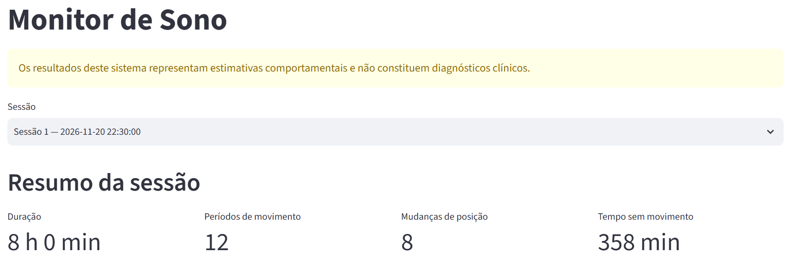
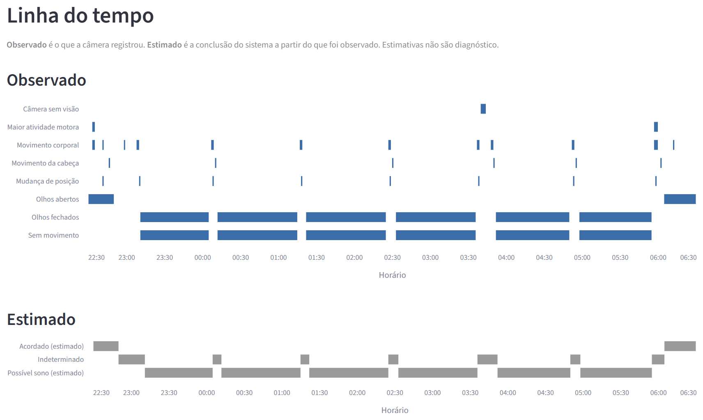
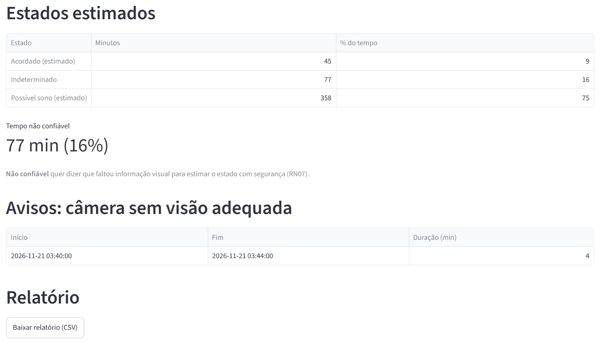

# Monitor de Sono

O Monitor de Sono é um programa que observa, por uma câmera, uma pessoa dormindo e mostra o que aconteceu
durante a noite.

> **Aviso importante:** os resultados são **estimativas**, não diagnóstico médico. O programa não
> substitui a polissonografia (o exame de sono feito em clínica) nem qualquer outro exame.

Projeto da disciplina **Tópicos Especiais em Engenharia de Software**, feito como estudo de caso.

---

## 1. O que ele faz

O programa assiste à gravação de uma noite (ou à câmera ao vivo) e anota, com o horário, o que a pessoa fez.
Por exemplo:

- às 23h10 a pessoa mudou de posição;
- das 23h11 à 0h05 ela ficou sem se mexer e com os olhos fechados;
- às 3h40 a câmera ficou 4 minutos sem conseguir ver a cena.

Com essas anotações, o programa tira conclusões sobre cada trecho da noite, como "acordado" ou "possível
sono". No fim, mostra tudo numa tela no navegador, com uma linha do tempo da noite, um resumo e um relatório
que pode ser baixado.

O que ele percebe na imagem:

- se há alguém à vista da câmera;
- o rosto e se os olhos estão abertos ou fechados;
- movimentos da cabeça;
- movimentos do corpo e mudanças de posição;
- trechos sem nenhum movimento;
- momentos em que a câmera não consegue ver direito (imagem escura, câmera tampada ou sem gravar).

## 2. O que ele não faz

- **Não faz diagnóstico** e não diz se a pessoa tem algum problema de saúde.
- **Não identifica as fases do sono** (N1, N2, N3 e REM). Essas fases são medidas pela atividade elétrica do
  cérebro, dos olhos e dos músculos, com sensores colados no corpo, e uma câmera não mede nada disso.
- **Não usa som.** Ele usa só a imagem da câmera.

## 3. Como funciona

Funciona como alguém que passa a noite olhando o quarto e anotando num caderno, com o horário, tudo o que muda.

```
câmera → o programa olha cada segundo → percebe movimentos, rosto e olhos → tira conclusões → guarda → mostra na tela
```

1. **A câmera grava.** Ela tem visão noturna (infravermelho), então enxerga mesmo com a luz apagada.
2. **O programa olha cada segundo.** De cada segundo do vídeo, ele pega uma imagem parada, chamada
   **quadro**. O horário de cada quadro vem da data e hora que a câmera escreve no canto da imagem, quando
   ela escreve.
3. **Ele percebe o que mudou.** Ele compara cada quadro com o anterior. Se uma parte pequena da imagem mudou,
   foi um **movimento**. Se uma parte grande mudou de uma vez, foi uma **mudança de posição**. Ele também
   procura o rosto e, quando o rosto aparece de frente, grande e nítido, confere se os olhos estão abertos ou
   fechados.
4. **Ele tira conclusões.** Com as regras do projeto, ele estima o estado da pessoa em cada trecho:
   - **acordado (vigília):** olhos abertos por pelo menos 1 minuto seguido;
   - **possível sono:** olhos fechados durante um trecho de pelo menos 5 minutos sem nenhum movimento;
   - **indeterminado:** qualquer trecho em que faltou informação para decidir.
5. **Ele guarda os resultados** num arquivo de banco de dados no próprio computador.
6. **Ele mostra na tela** os resultados num painel que abre no navegador, chamado **dashboard**.

Ficar parado não basta para o programa concluir que a pessoa está dormindo: ele também precisa ver os olhos
fechados. Quando a pessoa está de lado, coberta ou longe da câmera, os olhos quase não aparecem. Nesses casos, o
estado fica **indeterminado**.

## 4. O que você vê na tela

Imagens com uma sessão de exemplo, com dados inventados. Por privacidade, nenhum resultado de gravação real
aparece aqui.

### Resumo da sessão



No alto ficam o aviso de que os resultados não são diagnóstico e a lista para escolher a **sessão** (uma
noite analisada). Logo abaixo vem o resumo da noite:

- quanto tempo durou a sessão;
- quantas vezes a pessoa se mexeu;
- quantas vezes ela mudou de posição;
- quanto tempo ela ficou sem se mexer.

### Linha do tempo



Cada barra é um trecho da noite, no horário em que aconteceu. A tela separa dois tipos de informação:

- **Observado** (barras azuis) é o que a câmera viu: movimentos, mudanças de posição, olhos abertos ou
  fechados, trechos sem movimento e trechos em que a câmera ficou sem visão.
- **Estimado** (barras cinza) é o que o programa concluiu a partir do que foi observado: acordado, possível
  sono ou indeterminado.

**Indeterminado** quer dizer que faltou informação para concluir. Nesse caso, o programa não arrisca um palpite.

### Estados estimados, avisos e relatório



- **Estados estimados:** quantos minutos, e que parte da noite, ficaram em cada estado.
- **Tempo não confiável:** quanto do tempo estimado não teve informação suficiente na imagem. Todo trecho
  indeterminado conta como não confiável.
- **Avisos: câmera sem visão adequada:** os trechos em que a câmera não conseguiu ver a cena, com início, fim
  e duração.
- **Baixar relatório (CSV):** baixa um arquivo CSV, um formato de tabela que abre em programas de planilha. Ele traz o aviso de
  que não é diagnóstico, um resumo da sessão e a lista de tudo o que foi observado e estimado, com o horário.
  Uma coluna indica se cada estado estimado é confiável.

No fim da página também dá para **excluir** uma sessão e todos os dados dela.

## 5. Como usar

O uso tem duas etapas:

1. **Analisar** uma gravação (ou a câmera ao vivo). O resultado vira uma **sessão** salva no banco
   `dados/monitor_sono.db`.
2. **Abrir o dashboard** no navegador para ver as sessões: linha do tempo, resumo e relatório em CSV.

Antes de tudo, instale o **Python 3.11 ou mais novo** pelo site <https://www.python.org/downloads/>. O Python é
a linguagem em que o programa foi escrito, e ele precisa estar instalado para o programa rodar. No Windows,
marque a opção **"Add python.exe to PATH"** na primeira tela do instalador.

### 5.1 Jeito mais fácil (Windows): clique duplo no `iniciar.bat`

1. Baixe o projeto: no GitHub, **Code → Download ZIP**, e extraia a pasta (ou use `git clone`).
2. Abra a pasta do projeto e dê **dois cliques em `iniciar.bat`**.
   - Na **primeira vez**, ele prepara tudo sozinho: cria a pasta `.venv` e instala as bibliotecas (os
     componentes prontos que o programa usa). Precisa de internet e leva alguns minutos. Nas outras vezes, o
     menu abre direto.
   - Se o Windows mostrar "O Windows protegeu o computador", clique em **Mais informações → Executar assim
     mesmo**. Isso acontece com qualquer arquivo `.bat` baixado da internet.
3. Escolha uma opção apertando o número:

| Tecla | O que faz |
|---|---|
| **1** | Abre o dashboard no navegador (<http://localhost:8501>). Deixe a janela preta aberta enquanto usa; para fechar, aperte `Ctrl+C` nela ou feche a janela. |
| **2** | Pergunta se a pessoa gravada assinou o termo de consentimento, abre uma janela para escolher o vídeo (dá para escolher mais de um) e analisa. No fim, oferece abrir o dashboard. |
| **3** | Roda os testes automáticos, que conferem se o programa está funcionando. |
| **4** | Sai. |

**Atalho:** arraste um ou mais vídeos para cima do `iniciar.bat`. Ele analisa os vídeos direto, sem passar
pelo menu.

### 5.2 Passo a passo pelo terminal (Windows, Linux e macOS)

O terminal é a janela em que se digitam comandos.

**1. Abra um terminal na pasta do projeto.** No Windows, abra a pasta no Explorador de Arquivos, clique na
barra de endereço, digite `cmd` e aperte Enter.

**2. Crie o ambiente do projeto (só na primeira vez).** O comando cria a pasta `.venv`, com um Python
separado só para este projeto:

```bat
python -m venv .venv
```

No Linux e no macOS, use `python3` no lugar de `python`.

**3. Ative o ambiente (toda vez que abrir um terminal novo).** Depois disso, a linha do terminal começa
com `(.venv)`.

| Terminal | Comando |
|---|---|
| Prompt de Comando (cmd) | `.venv\Scripts\activate` |
| PowerShell | `.venv\Scripts\Activate.ps1` |
| Git Bash | `source .venv/Scripts/activate` |
| Linux / macOS | `source .venv/bin/activate` |

**4. Instale o projeto e as bibliotecas (só na primeira vez).**

```bat
pip install -e .
```

A instalação precisa ser **editável** (`-e`). O programa acha a pasta `dados/` a partir do local do
código-fonte, e uma instalação normal colocaria o programa em outro lugar. Quem já tinha o `.venv` com o
OpenCV 5 precisa rodar este comando de novo, porque o projeto exige `opencv-python>=4.9,<5`.

**5. Analise uma gravação.** Use aspas quando o caminho tiver espaços:

```bat
python -m monitor_sono analisar "C:\caminho\da\gravacao.mp4" --autorizado
```

- `--autorizado` confirma que a pessoa gravada assinou o termo de consentimento. Sem ele, o comando não roda.
- Uma noite de cerca de 4 horas leva de 10 a 15 minutos num notebook comum. Não feche o terminal até a linha
  de comando voltar. No fim, aparece um resumo: início e fim, comportamentos encontrados e interrupções da
  gravação.
- Os horários vêm da data e hora que a câmera grava no canto da imagem. Isso corrige o relógio do vídeo e
  marca como "câmera sem visão" os trechos em que a câmera parou de gravar.
- `--inicio "2026-11-20 22:30"` só é usado quando a câmera não grava data e hora legíveis na imagem. Sem
  ele, a sessão começa no momento da análise.
- Para usar a câmera ao vivo, troque o caminho pelo número da câmera: `analisar 0 --autorizado`. `Ctrl+C`
  encerra a sessão.
- Cada análise cria uma sessão nova. Analisar a mesma gravação duas vezes deixa a sessão repetida no
  dashboard, e ela pode ser excluída por lá.

**6. Abra o dashboard.**

```bat
streamlit run src/monitor_sono/dashboard/app.py
```

O navegador abre em <http://localhost:8501>; se não abrir, digite o endereço. Escolha a sessão na lista do
topo. Deixe o terminal aberto enquanto usa; `Ctrl+C` fecha o dashboard. A análise e o dashboard rodam
separados (o dashboard só lê o banco), então dá para deixar o dashboard aberto num terminal e analisar em
outro. Depois de uma análise nova, aperte `F5` no navegador.

**7. Rode os testes (opcional).**

```bat
pip install pytest
pytest --basetemp .pytest-tmp
```

O `--basetemp` evita um erro de permissão do Windows quando o pytest apaga os arquivos temporários.

### 5.3 Problemas comuns

| O que aparece | O que fazer |
|---|---|
| `'python' não é reconhecido como um comando` | O Python não está instalado ou não está no PATH. Reinstale marcando "Add python.exe to PATH", ou use `py` no lugar de `python`. |
| `No module named monitor_sono` ou `No module named streamlit` | O ambiente não está ativado (passo 3) ou a instalação não foi feita (passo 4). |
| PowerShell: "a execução de scripts foi desabilitada neste sistema" | Use o Prompt de Comando (cmd), ou rode uma vez `Set-ExecutionPolicy -Scope CurrentUser RemoteSigned`. |
| O dashboard abre em outra porta (8502, 8503...) | Já existe um dashboard aberto em outra janela. Use aquele, ou feche a outra janela. |
| A análise para com uma mensagem sobre a câmera ou o caminho | Confira o caminho do vídeo (com aspas) ou o número da câmera. |
| `PermissionError` no fim do `pytest` | Rode com `--basetemp .pytest-tmp`, como no passo 7. |

## 6. Privacidade

Filmar uma pessoa dormindo gera **dados pessoais sensíveis**, que a LGPD (Lei Geral de Proteção de Dados)
protege de forma especial. Por isso:

- **Só com consentimento:** a pessoa gravada precisa assinar um termo de consentimento antes da gravação. O
  programa não analisa nada sem a confirmação de que o termo foi assinado.
- **O que fica guardado:** as sessões, com o horário de cada comportamento observado e de cada estado estimado.
  O programa não salva imagens do vídeo.
- **Onde fica guardado:** só no computador em que o programa roda, no arquivo `dados/monitor_sono.db`.
- **Vídeos e resultados não vão para a internet:** a análise e o dashboard rodam no próprio computador. Os
  vídeos e o banco de dados nunca são enviados ao GitHub nem a nenhum serviço na nuvem.
- **Dá para apagar:** cada sessão pode ser excluída pelo dashboard, com todos os dados dela.
- Endereços de câmera com usuário e senha nunca ficam escritos no código.

## 7. Pequeno glossário

| Termo | O que quer dizer |
|---|---|
| **Sessão** | Uma noite (ou um trecho) analisada, do início ao fim. Cada análise cria uma sessão. |
| **Quadro** | Uma imagem parada tirada do vídeo. O programa analisa um quadro por segundo. |
| **Observado** | O que a câmera viu: movimentos, mudanças de posição, olhos abertos ou fechados, câmera sem visão. |
| **Estimado** | O que o programa concluiu a partir do que foi observado. É uma estimativa, não um diagnóstico. |
| **Indeterminado** | Trecho em que faltou informação para concluir. O programa prefere não arriscar um palpite. |
| **Vigília** | Estado "acordado": a pessoa ficou com os olhos abertos por pelo menos 1 minuto seguido. |
| **Possível sono** | Os olhos ficaram fechados durante um trecho de pelo menos 5 minutos sem nenhum movimento. É uma estimativa pelo comportamento, não uma fase do sono. |

## 8. Para quem vai mexer no código

### Regra do projeto

**Nada é implementado fora da lista de requisitos.** Se algo parecer necessário e não estiver na lista,
primeiro vira requisito aprovado, depois vira código.

| Documento | O que tem |
|---|---|
| [`docs/requisitos.md`](docs/requisitos.md) | Lista de requisitos vigente (RF, RNF e RN) |
| [`docs/rastreabilidade.md`](docs/rastreabilidade.md) | Requisito → arquivo → função → situação, e as decisões pendentes |
| [`docs/material-documentacao.md`](docs/material-documentacao.md) | Como o sistema funciona, resultados do estudo de caso, parâmetros e limitações |
| [`AGENTS.md`](AGENTS.md) | Regras para qualquer IA que trabalhe no repositório |

Os limites e tempos usados nas regras ficam em `src/monitor_sono/config.py`. Eles são **provisórios** e ainda
precisam ser confirmados com um gabarito das gravações.

### Estrutura de pastas

```
monitor_sono/
├── README.md                    Este arquivo
├── iniciar.bat                  Windows: menu com clique duplo (prepara, analisa, abre o dashboard, testa)
├── AGENTS.md                    Regras para IA
├── pyproject.toml               Pacote, dependências e configuração do pytest
├── requirements.txt             Dependências
├── .gitignore                   Mantém gravações, banco e ambiente fora do git
├── .gitattributes               Mantém o iniciar.bat com fim de linha do Windows
├── agents-context/              Histórico do que a IA fez
├── docs/
│   ├── requisitos.md            Lista de requisitos (RF, RNF, RN)
│   ├── rastreabilidade.md       Requisito → arquivo → função → status
│   ├── material-documentacao.md Uso, resultados do estudo de caso, parâmetros e limitações
│   └── imagens/                 Prints do dashboard com uma sessão de exemplo
├── tests/
│   ├── test_captura.py          Testes da captura (RF02, RNF08)
│   ├── test_deteccao.py         Testes da detecção (RF03 a RF07, RF15)
│   ├── test_classificacao.py    Testes da classificação (RF09 a RF11, RN01 a RN07)
│   ├── test_dashboard.py        Testes do dashboard (RF13, RF14, RNF09, RNF10, RNF12)
│   ├── test_pipeline.py         Teste de ponta a ponta com vídeo sintético e linha de comando
│   └── test_registro.py         Testes do banco (RF01, RF08, RF12, RNF05, RNF10)
└── src/
    └── monitor_sono/
        ├── __init__.py          Versão do pacote
        ├── __main__.py          Linha de comando (python -m monitor_sono analisar)
        ├── config.py            Caminhos, parâmetros e aviso de não diagnóstico
        ├── tipos.py             Formatos dos dados trocados entre os módulos
        ├── pipeline.py          Liga captura → detecção → classificação → registro
        ├── sessao/              RF01         iniciar e encerrar sessão
        ├── captura/
        │   ├── video.py         RF02         capturar imagens em tempo real
        │   └── carimbo.py       RNF04        ler a data e hora gravadas na imagem
        ├── deteccao/
        │   ├── presenca.py      RF03         detectar presença
        │   ├── rosto.py         RF04         detectar rosto
        │   ├── olhos.py         RF05         estado dos olhos
        │   ├── cabeca.py        RF06         movimentos da cabeça
        │   ├── movimento.py     RF07         movimentos corporais
        │   └── visibilidade.py  RF15         visibilidade insuficiente
        ├── classificacao/
        │   ├── comportamentos.py RF09        classificar comportamentos
        │   ├── estados.py       RF10         estimar estados
        │   └── periodos.py      RF11         períodos de atividade/inatividade
        ├── registro/
        │   └── banco.py         RF08, RF12   registrar comportamentos e estados
        └── dashboard/
            └── app.py           RF13, RF14   histórico, relatório e visibilidade
```

A pasta `dados/` é criada automaticamente na primeira execução. Ela guarda o banco e **nunca vai para
o git**.

### Tecnologias

| Ferramenta | Uso | Licença |
|---|---|---|
| Python 3.11+ | Linguagem | PSF |
| OpenCV 4.x | Captura de vídeo e visão computacional (o 5.x não traz as cascatas Haar de rosto e olhos) | Apache 2.0 |
| SQLite | Banco local em um único arquivo, sem servidor | Domínio público |
| Streamlit | Dashboard | Apache 2.0 |
| pandas | Organização dos dados para o dashboard | BSD |
| Altair | Gráficos da linha do tempo no dashboard | BSD |
| pytest | Testes | MIT |

Todas as licenças são permissivas. Ultralytics (YOLO) e Grafana são AGPL-3.0, e OpenPose é só para uso
acadêmico: se alguma delas entrar no projeto, isso precisa ser registrado nas decisões da equipe.

### Testes

Os testes usam só dados gerados no próprio código e um banco temporário, nunca gravações reais:

```bat
pytest --basetemp .pytest-tmp
```
